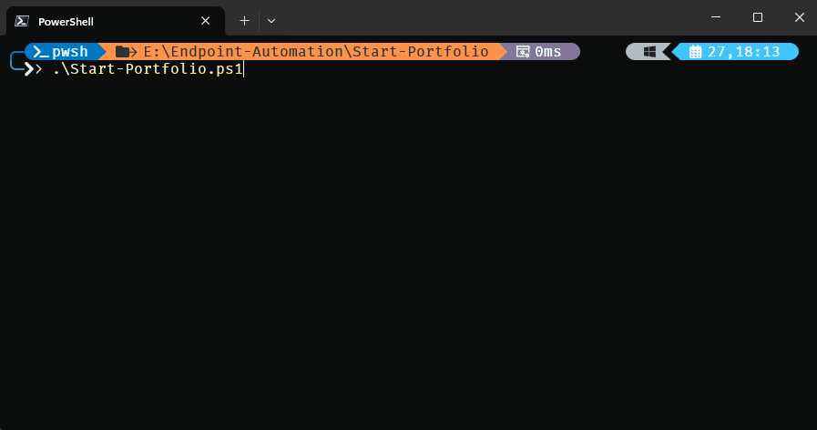

# David R. Cushman | Endpoint Engineering Portfolio

[Engineering Investigations](#engineering-investigations) · [Project Selection Criteria](./docs/project-selection.md) · [Portfolio Roadmap](./docs/portfolio-roadmap.md)

## About Me

I build endpoint platforms and engineering foundations for Microsoft environments, with a focus on PowerShell automation, governance, and reliability.

I'm naturally drawn to deconstructing systems to understand how they work, where their abstractions end, and how they behave when things go wrong. Much of my recent PowerShell and AI-assisted engineering work has grown from that same approach: examining what it means to develop trustworthy automation, then turning what I learn into practical tools, standards, tests, and workflows.

## Reliable. Repeatable. Governable.

This portfolio shows how I approach engineering work that must be reliable in production, repeatable across teams and environments, and governable over time.

### Reliable

Engineering should produce systems that are dependable, verifiable, and safe to trust in production.

- if a step is not verified, it is not complete
- automation should reduce operational risk, not simply save time

### Repeatable

Engineering should produce results that remain consistent across operators, environments, and future maintenance.

- reusable engineering foundations should reduce environmental drift
- automation should remain maintainable throughout its lifecycle

### Governable

Engineering should remain understandable, reviewable, and maintainable as systems evolve.

- documentation should preserve engineering intent, not just implementation details
- automation should be guided by standards, validation, and explicit review boundaries

## Engineering Investigations

Each investigation collects a cohesive body of engineering work around a technical problem, operational requirement, or engineering question. The code is part of the evidence; documentation, architecture, validation, and deliberate tradeoffs show how the work was approached.

### [PowerShell Engineering](./projects/powershell-engineering/README.md)

An investigation into the practices, tooling, runtime boundaries, validation, and lifecycle decisions needed to build and maintain reliable PowerShell solutions. It connects reusable PowerShell development foundations with applied endpoint, deployment, and operational automation projects.

Explore the [investigation](./projects/powershell-engineering/README.md) and its project case studies.

### [Administrative Template Lifecycle Management](./projects/admx-lifecycle-management/README.md)

An investigation into preserving vendor administrative-template distributions as traceable, verifiable deployment dependencies. It connects a reusable archive template with a fictional, populated reference implementation.

Explore the [investigation](./projects/admx-lifecycle-management/README.md).

## Engineering Approach

I build endpoint and automation solutions for environments where reliability matters, drift is expensive, and change has to be handled deliberately. The work is selected to show practical engineering investigations rather than to inventory every script or experiment.

I am most drawn to work at the intersection of endpoint engineering at enterprise scale, automation that reduces operational risk, platform modernization across on-premises and cloud-connected tooling, and documentation and process design that keep systems supportable over time.

## How I Use AI

AI is part of my engineering process, but it is not the source of engineering judgment.

I use AI as a drafting and reasoning accelerator throughout investigation, implementation, review, documentation, and maintenance. Repository instructions, task-specific skills, defined behavioral expectations, and repeatable interaction workflows provide boundaries for how AI participates in the work.

Those controls guide behavior; they do not prove that generated code is correct. AI-generated work is evaluated, challenged, and refined, then validated through engineering controls such as code review, PSScriptAnalyzer, Pester testing, CI, and observed system behavior. Tests and validation are themselves reviewed to ensure they provide meaningful evidence that the implementation satisfies the intended requirements.

The goal is to gain the speed and flexibility of AI assistance without delegating engineering accountability to it. Human judgment remains responsible for defining the problem, evaluating risk, deciding what good looks like, and determining whether the final result is correct, safe, maintainable, and worth keeping.

## Professional Background

My background includes enterprise endpoint engineering in financial services and energy infrastructure, with practical experience in:

- Configuration Manager (ConfigMgr / MECM / SCCM)
- Microsoft Intune and modern endpoint management
- Windows deployment and platform lifecycle engineering
- PowerShell automation
- Active Directory and Group Policy
- Microsoft 365, Azure, and security-aligned platform administration

Professional profile: [LinkedIn](https://www.linkedin.com/in/davidrcushman/).

## Usage Notice

This repository is provided for portfolio and evaluation purposes.

See [`NOTICE.md`](./NOTICE.md) for rights and usage details.
